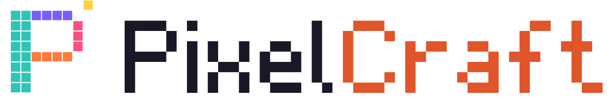

<p align="center">
  
</p>

**PixelCraft** é um editor de pixel art e animação quadro a quadro para Linux,
pensado para quem está começando e rápido para quem já desenha sprites.
Funciona offline, guarda os projetos apenas no seu computador e não tem
telemetria.

> Versão 0.1.0. O que está pronto, o que falta e as próximas ideias estão em
> [docs/ROADMAP.md](docs/ROADMAP.md).

## Funcionalidades

* **Desenho:** lápis, pincel com opacidade, borracha, linha, retângulo, elipse
  (contorno e preenchidos), balde com tolerância, degradê linear/radial com
  pontilhado ordenado, texto com fonte bitmap acentuada e conta-gotas. Simetria
  horizontal e vertical. Shift trava ângulos e proporções.
* **Seleção:** retangular, laço e varinha mágica (adicionar, subtrair,
  intersectar), mover com Alt para duplicar, girar, espelhar e escalar a
  seleção, copiar e colar com a área de transferência do sistema.
* **Camadas:** grupos aninhados, opacidade, modos de mesclagem, bloqueio,
  camadas de referência fora da exportação, etiquetas de cor, mesclar para
  baixo ou tudo, arrastar e soltar.
* **Animação:** linha do tempo com miniaturas, duração por quadro, FPS,
  repetir, uma vez ou vai e volta, papel vegetal, marcadores de trecho,
  células vinculadas e reprodução no canvas.
* **Cores:** seletor HSV com HEX/RGBA/HSL, paletas incluídas e próprias,
  importação e exportação GPL/HEX/JSON/JASC/ACT, análise de cores fora da
  paleta e redução de cores.
* **Imagem:** tamanho da tela com âncora, redimensionar, cortar, aparar, girar,
  espelhar, deslocar com repetição, substituir cor.
* **Tiles:** grade de tiles, modo mosaico para conferir emendas e exportação de
  tileset sem repetições com mapa do Tiled (`.tmj`).
* **Importar:** PNG, GIF animado, JPEG, WebP, BMP, imagem como camada e
  spritesheet fatiada em quadros.
* **Exportar:** PNG, JPEG, WebP e BMP em escala inteira, GIF animado,
  spritesheet com JSON, sequência de PNG e tileset.
* **Projetos `.pixelcraft`:** ZIP versionado e validado, gravação atômica,
  recentes com miniatura, salvamento automático e recuperação após falhas.
* **Fluxo:** paleta de comandos (Ctrl+K), atalhos configuráveis com detecção
  de conflitos, histórico navegável, temas escuro, claro e do sistema,
  primeiros passos para iniciantes.
* **Privacidade e segurança:** funciona offline, sem telemetria, sem anúncios;
  processo de interface isolado e arquivos acessíveis só quando você os escolhe.

## Requisitos

* Linux x86_64 com glibc 2.31+ (Ubuntu 20.04+, Debian 11+, Fedora 36+ ou
  equivalente) para os pacotes.
* Para desenvolver: Node.js 22+ e npm 10+.

## Desenvolvimento

```bash
npm install          # dependências
npm run dev          # executa com recarga automática
npm run typecheck    # TypeScript estrito
npm run lint         # ESLint
npm test             # testes unitários
npm run test:e2e     # testes de interface (precisa de display; use xvfb-run em servidores)
npm run build        # build de produção (dist/ e dist-electron/)
npm start            # executa o build de produção
```

## Pacotes Linux

Veja [docs/BUILD_LINUX.md](docs/BUILD_LINUX.md).

```bash
npm run package:deb        # release/pixelcraft_<versão>_amd64.deb
npm run package:appimage   # release/PixelCraft-<versão>-x86_64.AppImage
npm run package:flatpak    # release/PixelCraft-<versão>.flatpak
```

## Documentação

* [Arquitetura](docs/ARCHITECTURE.md)
* [Formato .pixelcraft](docs/PROJECT_FORMAT.md)
* [Build dos pacotes Linux](docs/BUILD_LINUX.md)
* [Testes](docs/TESTING.md)
* [Atalhos](docs/SHORTCUTS.md)
* [Primeiros passos](docs/TUTORIAL.md)
* [Roadmap](docs/ROADMAP.md)
* [Como contribuir](CONTRIBUTING.md)

## Licença

MIT, veja [LICENSE](LICENSE). Logotipo, ícones e a fonte bitmap
"PixelCraft Sans 5×7" foram criados para o projeto e seguem a mesma licença.
As dependências e suas licenças estão listadas em
[docs/THIRD_PARTY.md](docs/THIRD_PARTY.md).
